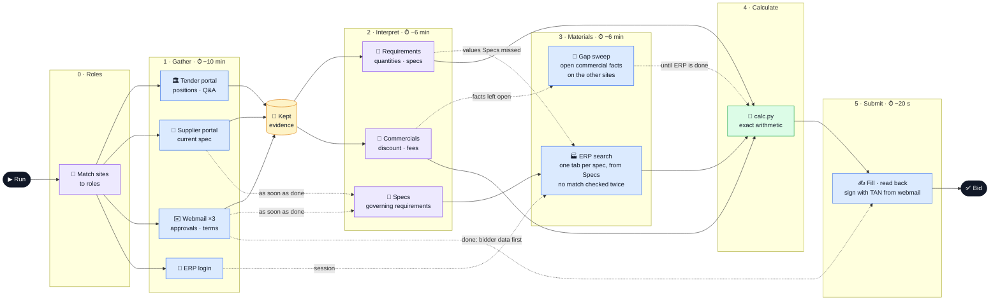

# adminrights

Our agent system for the Atira hackathon challenge [`rfq`](https://ehl-challenge.atira.ai/challenges/rfq.md): it
turns a public tender into one signed bid. Four websites, 20 minutes, no human in the loop. Models decide where to go
and what matters; code reads pages, keeps evidence and does the arithmetic.



Blue: a model working a website in its own tab. Purple: a model call without a browser. Green: code. Times are hard
deadlines counted back from the end of the run's budget (at most 19 min); a phase cut at its deadline hands on what it
has. Source of truth: `main` in [`agent/agent.py`](agent/agent.py).

| Where | What |
| --- | --- |
| [`agent/`](agent/README.md) | The package we upload: orchestration, agents, browser tools, `calc.py` |
| [`docs/`](docs/README.md) | Rules we are judged by, the plan, one README per agent |
| `eval/`, `tests/`, `tools/` | Reference answers and scorer, tests, dev helpers; stay local |

```sh
atira models proxy                                  # terminal 1, keep it open
cd agent && eval "$(atira scout --env)"             # terminal 2
HEADLESS=1 uv run --no-sync python agent.py         # one local run
tools/score.sh                                      # from the repo root: local dry run with points per field
atira test-run .                                    # sandbox run with points per field
```
