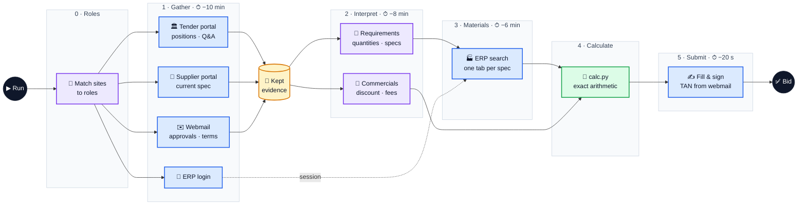

# adminrights

Team AdminRights' agent system for the Atira hackathon challenge
[From RFQ to bid](https://ehl-challenge.atira.ai/challenges/rfq.md): it reads a public tender across four websites
and enters one priced, signed bid, with no human in the loop. Rules, plan and work split live in [docs/](docs/README.md).

## Model flow

🟦 browser agent (a model clicks, searches and keeps pages) · 🟪 single model call on the kept evidence ·
🟩 code · ⏱ hard cut, measured back from the end of the run budget (19 min)
