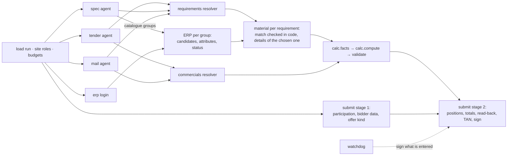

# Implementation plan

> **How the system works, how it must change, and who builds what.** Combined from both earlier plans (ours and
> Luca's architecture notes) and the analysis of his agent on `main`. Every rule and its ID: [RULES.md](RULES.md)
> (T0–T4 platform rules, 1–29 bid rules). Why the plan looks like this: [PLAN_COMPARISON.md](PLAN_COMPARISON.md)
> (`F#` = its findings). No public-1 values in this file.

---

## 0. In short

The agent on `main` works the four websites with one generic model tool loop, applies the bid rules through two
model "resolvers" and an exact code calculator, and enters the bid with a model-driven submit agent. In a full local
dry run its resolvers got **every fact right**, and the run still failed. The answer came only after 17 minutes,
and it was a false **no-bid**, because the ERP agents started after their own deadline and reported "no match" for
searches they never ran (PLAN_COMPARISON §2.4).

So the work goes in this order (backlog §12):

1. **P0, a correct signed bid in time:** unfinished ≠ no match; per-stage budgets and dependency scheduling;
   deadline-bounded model calls; slimmer missions; submission in two stages with a watchdog; dry-run scoring and
   release tools; first test run and scored submission.
2. **P1, correctness under pressure:** strict numbers, code checks of the material decision, mail topics from the
   brief, retries and re-login in code, calculator tests.
3. **P2, private-dataset readiness:** gap sweep, reader hardening, code-side selection as a cross-check, extraction
   while browsing, mutation tests.
4. **P3, polish.**

---

## 1. How we win

1. **Reading decides, not maths.** The sites are adversarial (hidden decoys, images, tooltips, look-alikes,
   superseded versions, mixed number formats). A generic, trap-aware page reader transfers to the private sites.
2. **The bid rules are fixed; the websites are not.** Rules belong in tested code; websites belong to the model.
3. **The puzzle is a chain of keys:** position → requirement → current revision → catalogue group → material →
   condition, stock, masses, index key; Q&A answers assign keys and mails resolve them. Anything that finds an
   unresolved key and goes looking for it survives "information split differently".
4. **The material decision is the most valuable judgement:** a no-bid case gives 75 points for the decision alone,
   and a false no-bid throws away every position (RULES 4.2).
5. **At equal quality, cost × time wins:** parallel sites, small inputs, a cheap hosted model, an early start on the
   submission.
6. **Always submit:** a run without an answer scores 0; every field scores on its own.
7. **The final takes the latest passed submission, not the best:** release discipline is a scoring factor. Best of 3
   costs us nothing with hosted models: opt in.

## 2. Principles

| # | Principle | Rules |
| --- | --- | --- |
| 1 | A model decides where to go, what to search and which documents matter; code reads, fetches, fills, checks and calculates | T0.3, T0.4 |
| 2 | Facts come from kept evidence only, never from a model's memory; decisive values carry the quote they came from | T4.2 |
| 3 | Selection rules and arithmetic are code; a model's pick is checked, never the only key | 1–29 |
| 4 | Unfinished is not absent: a search that didn't complete never counts as a result | 3, 8, 9 |
| 5 | Always submit: every stage has its own budget, model calls respect it, a watchdog signs what is entered | T1.3 |
| 6 | Nothing assumes what public-1 looks like: no values, no site ids, no information locations | T0.1, T1.12, 19 |
| 7 | Small model inputs, stable prompt prefix | T3.4 |
| 8 | Add behaviour through existing hooks (`investigate`, `check`, `safe`, `calc`); no new framework | T4.1 |
| 9 | Every change ships with a test or a scored dry run, and its docs in the same commit | T4.3, T4.7 |

---

## 3. The system today (`main`)

### 3.1 Run outline

`agent/agent.py` `main`: budget = min(time left, 19 min), `end` = start + budget.

```
Phase 0, no browser
    resolvers.sites: a model assigns each website its role from the brief (names and ids differ per dataset)
Phase 1, parallel, one browser each, wrap-up at end − 10 min, hard cut 30 s later
    tender_portal.run · supplier_portal.run · webmail.run · erp.login
Phase 2, no browser, hard cut end − 8 min (one retry with low effort until end − 7 min)
    resolvers.requirements (resolvers.commercials starts too and runs alongside phase 3)
Phase 3, ERP tabs in parallel, hard cut end − 6 min (a cut search → its positions are omitted)
    erp.run per distinct requirement; then resolvers.commercials, hard cut end − 5.5 min
Phase 4, code
    calc.facts → calc.compute
Phase 5, deadline end − 20 s
    submit.run (+ get_tan in the webmail tab)
```

With fewer than 4 browsers, the remaining sites open as tabs in browser 1. Every phase is cut hard by `safe`
(`asyncio.wait_for`): an agent that overruns or crashes yields an empty result and the run moves on. Under load the
hosted model can take 20–90 s per step; without hard cuts one run spent its whole budget before the submission and
scored 0.

### 3.2 Agents

Each agent is a folder `agent/agents/<name>/` with `agent.py` (mission, result schema, `run`) and `README.md`.

| Agent | Site | Mission | Limit |
| --- | --- | --- | --- |
| `tender_portal` | tender portal | positions and every Q&A, kept as evidence | 45 steps |
| `supplier_portal` | supplier portal | the revision marked current and all its requirements | 40 steps |
| `webmail` | webmail | every message the rules need, inbox and archive | 60 steps |
| `erp.login` | ERP | get past login, cookies, notices, gates | 20 steps |
| `erp.run` | ERP (one tab each) | the material for one requirement; its pages kept; `check` → `extract` reads the facts | 40 steps |
| `resolvers` | — | three `ask_json` calls: sites, requirements, commercials | 3 attempts each |
| `submit` | tender portal | fill the wizard, sign | 70 steps |
| `get_tan` | webmail | the newest TAN for the request just made | 12 steps, 2 min |

### 3.3 The tool loop (`agent/llm.py` `investigate`)

Every browser agent is the same loop; agents differ only in mission, result schema, deadline and step limit.

- **View:** `Tab.read` returns the page as text (`agent/reader.js`, §5.1), at most 14,000 characters per read; the rest
  via `offset`.
- **Tools:** `read`, `goto`, `click`, `fill`, `select`, `check`, `press`, `back`, `form` (a whole form by visible
  labels; survives reloads), `fetch` (read a same-site URL without navigating; opens ZIPs and PDFs), `save_evidence`
  (keep a page word for word), `note` (pin verified facts), `finish`.
- **Small context:** tool results of the last 4 steps stay in full (`KEEP_STEPS`); older ones shrink to 300 characters.
- **`finish`:** a result that isn't a JSON object is refused while more than 30 s remain.
- **`check`:** optional validator on `finish`: a problem refuses `finish` and the agent keeps working.
- **Time:** 60 s before the deadline the agent is told to finish; at the deadline `finish` is forced via `tool_choice`.
- **Model:** `AGENT_MODEL`, default the hosted Qwen; browser steps run with low reasoning effort (`STEP_EFFORT`);
  `chat` retries up to 6 times (360 s timeout each), bounded only by the phase's hard cut (F4).
- **Shared system prompt** `agents/common.py` `SYSTEM`: the sites' traps in general terms, no site and no value.

### 3.4 Resolvers, calculator, submission

- **Resolvers** (`agents/resolvers`): one `ask_json` call each (JSON mode, up to 3 attempts). `sites`: which website
  plays which role, from the brief. `requirements`: final quantities and governing requirements; `commercials`:
  discount, clauses, tariffs, commitments, pool and bonus membership, setup fees, FX rates, metal indices, pool fee,
  bonus bands. Reasoning effort is medium for `requirements` and `commercials`, low for copying values (`sites`,
  ERP `extract`).
- **Calculator** (`agent/calc.py`, details in [calc.md](calc.md)): `facts` merges the agents' results, `compute`
  applies rules 3–9, 12, 15–18 and 22–27 in `Decimal` with HALF_UP; exact against the reference (PLAN_COMPARISON §2.3).
- **Submission** (`agents/submit`): one model agent with the `form` tool and German number formatting; `get_tan`
  runs in the mail tab; guardrails in the mission (no extra positions, omit only listed ones, never tick our own terms,
  one TAN request).

### 3.5 Logs

Every line goes through `llm.log` as `[tag  123s] ...` (seconds since start). `main` logs one line per stage
(`sites`, `tender-portal`, `supplier-portal`, `webmail`, `requirements`, `commercials`, `erp`, `facts`, `calc`, `answer`,
`submit`); every agent step
appears as `[tag  123s] n: tool {args}`.

### 3.6 Measured behaviour

Full local dry run (PLAN_COMPARISON §2.4): every resolver fact correct; answer only at 1029 s, a false no-bid scored
5 / 100; the tender agent took 12 minutes re-fetching the same pages, the ERP agents started after their deadline, and
one resolver call took about 5 minutes.

---

## 4. The target system

### 4.1 Flow

A dependency graph of `asyncio` tasks replaces the fixed phases: each task starts as soon as its inputs exist.



### 4.2 Budgets and the watchdog

- `end` = start + min(time left from `expires_at`, 19 min).
- Each stage gets `min(its normal budget, time left − the reserve later stages need)`, computed **when it starts**,
  never negative. A stage that can't get its minimum is skipped and its outputs count as unfinished.
- Reserve for submit stage 2: its measured duration plus a margin (start with 5 min; calibrate in the first test runs).
- **Watchdog** at `end − 3 min`: omit what is unfinished (rule 9), request the TAN, sign.
- Model calls take the caller's deadline: per-call timeout `min(90 s, time left − margin)`; no retries past it.
- Targets: signed in **< 8 min**, then toward 5 (T3.2).

### 4.3 Module map

`agent/` is the package; `eval/`, `tools/` and `docs/` stay local.

| Module | Responsibility | Interface (in → out) | Rules | Increments |
| --- | --- | --- | --- | --- |
| `agent.py` | dependency graph, site roles, data flow | run → signed bid | T1.3, T1.5, T1.12 | I3, I4 |
| `budget.py` *(new)* | per-stage budgets, `left()`, watchdog mark | `expires_at` + reserves → budgets | T1.3 | I4 |
| `llm.py` | `investigate`, `ask_json`, `chat` | unchanged signatures; `chat` honours the caller's deadline; reliable object `finish` | T1.3, T3.3 | I2, I5 |
| `browser.py`, `reader.js` | page text, actions, `form`, `fetch`, files | unchanged | T0.4 | I13, I17 |
| `agents/<name>/` | missions and result schemas | unchanged pattern | per agent README | I1, I5, I6, I12, I16 |
| `agents/resolvers` | model interpretation of evidence | unchanged outputs in P0/P1; candidate records added in P2 | 1, 2, 5, 12–14, 16, 17, 20–26, 28 | I5, I18 |
| `numbers.py` *(new, from `calc.number`)* | strict number and unit parsing | `(raw, hint)` → `Decimal` or error | 4, 22 | I10 |
| `calc.py` | `facts`, `compute` | unchanged; `Decimal` throughout; loud failures | 3–9, 12, 15–18, 22–27 | I10, I14, I15 |
| `validate.py` *(new)* | answer schema (from the run), arithmetic, ERP match check, no-bid gate | answer or ERP result → ok or problem text | T1.6, 3, 7, 8 | I1, I11 |
| `select.py` *(new, P2)* | `LATEST` selection as a cross-check of the resolvers | candidate records → governing values + conflicts | 1, 2, 5, 12–14, 16, 17, 20–26, 28 | I18 |

### 4.4 Contracts

**Unfinished vs no match (I1).** An ERP result counts as `no_match` only if, checked in code: the agent finished
before its deadline (not forced), its kept evidence contains the catalogue group's result list, and every listed
candidate was compared. Anything else is **unfinished**: retried if time allows, otherwise the position is omitted
(rule 9). A `no_bid` also needs the no-bid gate.

**ERP match check and no-bid gate (I11).** The existing `check` → `extract` hook also verifies in code: bore,
nominal stroke, pressure, mounting and certification equal the requirement; the status is active; the stock is the
available (unrestricted) one. A mismatch refuses `finish` with the exact difference. Before a `no_bid`, a second ERP
agent confirms independently.

**Candidate records (I18, P2).** Resolvers additionally list every candidate record they saw, raw as written, with
the model's own pick; another component selects:

```json
{
  "records": [
    {"kind": "discount_approval", "key": null, "reference": "<as written>", "sender": "<address>",
     "sent_at": "<as written>", "timezone_hint": "<site's stated zone or null>", "status_hint": "<sent/draft/...>",
     "values": {"percent": "<as written>", "min_order_value": "<as written or null>"},
     "quote": "<verbatim sentence from the evidence>"}
  ],
  "model_pick": {"discount_approval": "<index into records>"}
}
```

`select.py` checks each `quote` against the evidence, applies `LATEST` (RULES 4.1) and compares with `model_pick`;
on disagreement it logs both, re-asks once, then the rule wins.

---

## 5. Reading pages and handling obstacles

### 5.1 Page reader (`agent/reader.js`)

| # | Rule | Status |
| --- | --- | --- |
| 1 | Visibility truth: drop `display:none`, `visibility:hidden`, zero opacity or font size, `hidden`, `aria-hidden` | ✅ |
| 1b | Also drop off-screen, zero-size and clipped content; count what was dropped | ⏳ I17 |
| 2 | Reveal real values: image and canvas labels, tooltips, collapsed `<details>`, select options, input values | ✅ |
| 3 | Normalize text: remove invisible characters; keep number-format hints verbatim | ✅ |
| 4 | Controls as `[n:kind "label"]` refs the tools act on; links show their href | ✅ |
| 5 | Same-origin iframes inlined, nested ones too | ✅ |
| 6 | Tables with cell separators; page indicators stay in the text | ✅ |
| 7 | Open dialogs marked; in-page dialogs closed on every settle; browser dialogs accepted and reported | ✅ |
| 8 | Repeated page chrome (headers, banners) suppressed to save tokens | ⏳ optional, I17 |
| 9 | 14,000 characters per read, `offset` for the rest | ✅ |
| 10 | Screenshot fallback when text is missing | only if a test shows the need (E2) |

### 5.2 Obstacles

| Obstacle | Today | Change |
| --- | --- | --- |
| Cookie walls, login | the model | auto re-login when a login form appears mid-run (I13) |
| Modal dialogs | closed in code on every read | — |
| Transient error pages | the model retries | code-side retry before the model sees the page (I13) |
| Unlock gates | the model (`fill` on a slider, `check`) | — |
| Look-alike controls | the model, guided by hrefs | — |
| Fixed 1.4 s settle on every read | — | adaptive settle (I13) |

### 5.3 Documents, numbers and dates

- `fetch` and downloads: ZIP (recursive), CSV, TXT, HTML ✅; PDF needs the `pypdf` dependency (I17).
- Numbers are parsed by code with the stated format; ambiguous forms are refused, never guessed (I10, RULES 4.1).
- Dates are compared in UTC; models report them as written, with their timezone and format hints (I18).

---

## 6. Models

| Use | Model | How |
| --- | --- | --- |
| Navigation and reading (tool loop) | hosted Qwen | native tool calls; parallel tool calls allowed |
| Resolvers and ERP fact extraction | hosted Qwen | JSON mode, up to 3 attempts |
| Prose → class (condition rules) | hosted Qwen | majority of 3 only if tests show errors (E4) |
| Cheap yes/no checks | Clef | not used; only if measurably faster (E5) |
| Anything else | a frontier model via team secret | off; only behind a flag where it buys quality (E6) |

- Calls are bounded by the caller's deadline (I2); at most 12 concurrent calls per run (the team shares 32).
- Prompt layout: static system prompt and tool schemas first (cached input is cheaper), then brief, then dynamic parts.
- The system prompt teaches meanings (traps, German business terms), never values.
- Resolver inputs only carry the evidence they need (I5); later, extraction while browsing (I19).
- Cost: measure per test run; target ≤ $0.25 (T3.3).

---

## 7. The private dataset

Same jobs and rules, different software, look, navigation, site names and data, information split differently.

| Change | Defence |
| --- | --- |
| Other site ids or names | roles and submission target from the run (I3) |
| Other navigation and labels | model navigation over page text; generic prompts ✅ |
| Information on other sites | gap sweep for missing facts and unresolved keys (I16) |
| Other mail subjects | topics and senders from the brief (I12) |
| Other document formats | ZIP, CSV, TXT, HTML ✅; PDF (I17) |
| Other number and date conventions | strict parsing with hints (I10); UTC comparison |
| A no-bid scenario | unfinished ≠ no match (I1); no-bid gate (I11); mutation test with a blocked match |
| More positions, other units | nothing assumes a count or a unit ✅ |
| Known traps in a new skin | trap catalogue (RULES §8); mutation tests (I20) |

## 8. Staying compliant

- The package is `agent/` only; references and public-1 data live in `eval/`, outside it (T0.5).
- `tools/audit_package.py` (I8) checks `agent/` against every scouted value, site paths, key-shaped tokens and API keys
  before each submission; READMEs in the package count too (T0.1, T0.2, T0.6).
- Prompts and examples use synthetic values only.
- The log shows every navigation step as a model tool call (T0.3).
- Docs say plainly what the system does (T0.10); Luca approves every submission (RULES §9).

---

## 9. Testing and evaluation

| Level | What | Increments |
| --- | --- | --- |
| Unit tests | calc golden test with facts as the pages show them, allocation ties, band edges, inclusive ceilings and thresholds; number parser; validators; selection | I10, I11, I14, I18 |
| Recorded pages | pages saved from dry runs; reader tests for every trap category | I17 |
| Dry run + score | `DRY_RUN=1` stops before the binding confirmation and writes `answer.json`; `eval/compare.py` scores it with the official weights | I7 |
| Mutation tests | recorded pages relabelled, locale-swapped, nested in iframes, with injected decoys and shuffled rows: extraction must not change | I20 |
| Chaos runs *(stretch)* | local runs with random 503s, a forced session expiry, slow responses: the run must still sign | — |
| Mirror world *(stretch)* | a small local re-skin of the four jobs with information split differently and a synthetic scenario with a known answer | — |
| Sandbox test runs | the official per-field breakdown; paste each result in its PR | I9 |

Two independent references agree on every field: `eval/expected.json` (with `eval/derivation.md`) and `eval/oracle.py`.

**Experiments** (decide by data): E2 screenshot fallback · E3 browser and tab layout for the ERP fan-out ·
E4 voting for the clause classification · E5 Clef for yes/no checks · E6 a frontier model for the resolvers ·
E7 budget calibration in the sandbox.

## 10. Observability

Today: stage results, agent steps and the calculation trace in the log (§3.5). Add an end-of-run summary: time per
stage, model turns and tool calls per agent, resolver reasoning for decisive values (I21).

## 11. Repository layout

```
AdminRights/
├── AGENTS.md, CLAUDE.md, README.md
├── agent/                 # THE PACKAGE (only this is uploaded)
│   ├── agent.json, pyproject.toml, uv.lock, README.md
│   ├── agent.py, llm.py, browser.py, reader.js, calc.py, run.py, browsers.py
│   └── agents/<name>/     # agent.py + README.md per agent, common.py
├── docs/                  # what the system is and how we build it; no public-1 values
│   ├── README.md, RULES.md, IMPLEMENTATION_PLAN.md, PLAN_COMPARISON.md, calc.md, challenge.md
│   └── platform/          # dated copies of the platform docs
├── eval/                  # local: references, scorer, public-1 data
│   ├── expected.json, derivation.md, compare.py, oracle.py
│   └── public-1/          # scouting notes, brief, Q&A extract, scouting JSON, challenge and start pages (logins)
└── tools/                 # local: dev-env.sh; later the audit, release check and score script
```

---

## 12. Backlog

Owner letters: **L** = Luca, **Y** = Yazan, **F** = Finn (proposal, §14).

### P0: a correct signed bid in time

| ID | Change | Where | Acceptance | Rules | Owner |
| --- | --- | --- | --- | --- | --- |
| I1 | Unfinished ≠ no match (§4.4) | `agents/erp`, `validate.py`, `calc.compute` | a run with a starved ERP stage never answers no_bid | 3, 8, 9 | Y |
| I2 | Model calls bounded by the caller's deadline; concurrency cap | `llm.py` | test with a fake slow client | T1.3 | F |
| I3 | Site roles and submission target from the run; unknown ids classified once (URL + landing page) | `agent.py`, `agents/common.py` | a run with renamed site ids doesn't crash | T1.12 | L |
| I4 | Dependency graph + per-stage budgets (§4.1, §4.2) | `agent.py`, `budget.py`, `agents/erp` | dry run: ERP starts during the first stage; answer < 8 min | T1.3, T3.2 | L |
| I5 | Slimmer missions and inputs: no word-for-word copies in `finish` schemas when the evidence holds them; "every needed page kept → finish"; resolvers get only the evidence they need; reliable object `finish` | `agents/tender_portal`, `agents/supplier_portal`, `agents/resolvers`, `llm.py` | no page fetched twice without reason; commercials resolver much faster | T3.2, T4.2 | F |
| I6 | Submit in two stages + watchdog: stage 1 at start, stage 2 with the answer, read-back of the review page before the TAN, watchdog at end − 3 min | `agents/submit` | a short-budget run still signs | T1.3, T1.9, 9 | L |
| I7 | Dry-run mode + `tools/score.sh` (run + `eval/compare.py`) | `agents/submit`, `tools/` | one command → a score | T4.3 | Y |
| I8 | Release tools: `tools/audit_package.py` + `tools/check_release.sh` (audit, tests, `agent.json`) | `tools/` | green on `main` | T0.1, T0.2, T0.6, T1.1 | Y |
| I9 | First sandbox test run, then the first scored submission as a safety net | — | eligible and signed | D2, D3 | L |

### P1: correctness under pressure

| ID | Change | Where | Acceptance | Rules | Owner |
| --- | --- | --- | --- | --- | --- |
| I10 | Strict numbers: inline format hints used; ambiguous forms refused (the agent re-reads); thousands separators in grams; `Decimal` end to end | `numbers.py`, `calc.py` | parser tests incl. the probes in PLAN_COMPARISON §2.3 | 4, 22 | Y |
| I11 | ERP match check in code + no-bid gate (§4.4); answer schema and arithmetic validated before signing | `agents/erp`, `validate.py`, `agents/submit` | tests with look-alike and blocked candidates | T1.6, 3, 7, 8 | Y + L |
| I12 | Mail topics and senders parsed from the brief; generic wording for the approval search | `agents/webmail` | no public mail subject in prompts | T0.11, 5, 10, 21 | F |
| I13 | Code-side retry of transient error pages; auto re-login; adaptive settle | `browser.py` | fewer model turns on the ERP in the dry-run log | T3.2 | F |
| I14 | Calculator tests: golden test, allocation ties, band edges, inclusive ceilings and thresholds | `tests/` | green | 4–9, 12, 15–18, 22–27 | Y |
| I15 | Loud failures instead of silent fallbacks (FX, metal index); omitted positions per rule 9 | `calc.py` | tests | 9, 22, 28 | Y |

### P2: private-dataset readiness

| ID | Change | Where | Acceptance | Rules | Owner |
| --- | --- | --- | --- | --- | --- |
| I16 | Gap sweep: after the first pass, code lists missing facts and unresolved keys; short model missions to the other sites | `agent.py`, `agents/common.py` | a fake run with Q&A on another site still finds them | 10, 19 | F |
| I17 | Reader hardening (§5.1 rows 1b, 8); `pypdf` dependency | `reader.js`, `pyproject.toml` | recorded-page tests; a PDF is read | traps 8, 9 | F |
| I18 | Code-side selection cross-check (§4.4) | `agents/resolvers`, `select.py` | synthetic-record tests per trap category | 1, 2, 5, 12–14, 16, 17, 20–26, 28 | Y |
| I19 | Extraction while browsing: each kept page read into records right away (small parallel calls), so resolvers only select | `llm.py`, `agents/*` | resolvers finish in seconds after the last agent | T3.2, T4.2 | Y + F |
| I20 | Mutation tests on recorded pages | `tests/` | extraction stable | 19 | F + Y |

### P3: polish

| ID | Change | Owner |
| --- | --- | --- |
| I21 | End-of-run summary (§10) | L |
| I22 | Cosmetics (PLAN_COMPARISON F15); agent READMEs and this file describe the final system | all |

---

## 13. Process

- **Before every `atira submit`:** the Definition of Done in [RULES.md](RULES.md) §9.
- **Releases:** submissions only from `main`, tagged `sub-NN` with their test-run score (T4.4).
- **Freeze:** no experimental submissions in the last 3 hours; the last one must be at least as good as the release
  candidate (T4.5).
- **Final:** opt in to best of 3 (`atira final --best-of 3`) before the final run starts.
- **Shared capacity:** no local runs while a test run is going; one test run at a time.
- **PRs:** small, one increment each; name the increment and rule IDs; paste the dry-run score.

## 14. Work split and timeline

| Person | Owns | P0 | then |
| --- | --- | --- | --- |
| **Luca** (repo owner, knows the code) | orchestration, submission, releases | I3, I4, I6, I9 | I11 with Yazan, I21 |
| **Yazan** | correctness and tooling | I1, I7, I8 | I10, I11, I14, I15, I18 |
| **Finn** | model loop, missions, browser, generalization | I2, I5 | I12, I13, I16, I17, I19, I20 |

`H+0` = this plan on `main`. Sync every 3 hours (demo a scored dry run, re-plan).

| Window | Goal | Exit criterion |
| --- | --- | --- |
| H+0 – H+3 | P0 | a dry run signs in < 8 min with the right decision |
| ~H+3 | first sandbox test run, then the first scored submission (I9) | eligible, on the leaderboard |
| H+3 – H+9 | P1 | dry-run score ≥ 95 |
| H+9 – H+15 | P2 | mutation tests green; gap sweep proven |
| until 3 h before the end | tuning: time, cost, test-run breakdowns | release candidate tagged |
| last 3 h | freeze; final submission ≥ release candidate; best of 3 | final submission passed review |

## 15. Risks and open questions

| Item | Plan |
| --- | --- |
| Review rejects the package as scripted | model-directed navigation everywhere; the log shows it; no site-specific code |
| A public value slips into the package (prompt example, README) | audit before every submission (I8) |
| A run ends without an answer | budgets, deadline-bounded calls, watchdog (I2, I4, I6) |
| A false no-bid | I1 + I11 |
| Session expiry mid-wizard | step-by-step saving, re-login (I13), read-back (I6) |
| TAN race | one request, newest TAN after the request, 5-minute window |
| Site ids differ on the private dataset | I3 handles both |
| Information on unexpected sites | gap sweep (I16) |
| The scorer's "dated metal-index check" fields are unknown | RULES A6; confirm with the first test-run breakdown |
| Sandbox speed differs from local | calibrate budgets after the first test run (E7) |
| Resolver calls stay slow | slimmer inputs (I5), then extraction while browsing (I19) |
| The gap sweep could look like crawling | each sweep mission is a model decision about one named missing fact |
| Code-side selection disagrees with the model | log both; the rule wins after one re-ask (I18) |
| Our latest submission is worse than our best | freeze and Definition of Done (T4.5) |
