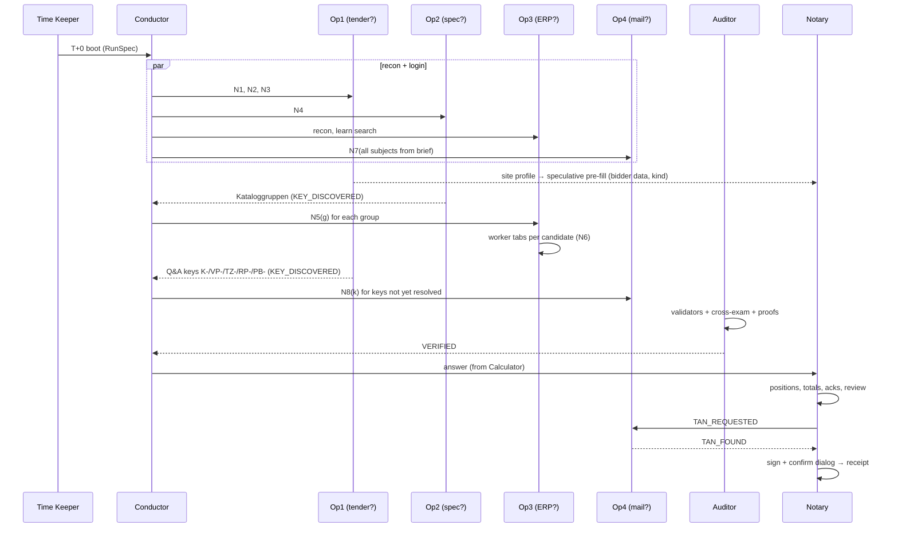

# Implementation plan: team AdminRights, "From RFQ to bid"

> Companion to [`RULES.md`](RULES.md) (what is required, rule IDs `T0.x`–`T4.x`) and
> [`scouting-notes.md`](scouting-notes.md) (what the public sites look like). This file is **how** we build it, **who**
> builds what, and **when**. Rule IDs in brackets show which requirement a design choice serves.

---

## 0. TL;DR

We build a **team of cooperating agents around a shared Evidence Ledger**:

- **4 Site Operators**, one per browser, each a model-driven navigator paired with a **Reader** that extracts
  quote-anchored facts. They are *site-agnostic*: they don't know which site holds what until they look.
- A **Conductor** turns the bid rules into an **information-need graph**. It routes each need to the operator whose
  site profile fits, and grows the graph as new keys are discovered (`K-…`, `VP-…`, `TZ-…`).
- An **Auditor** red-teams every critical fact (two-key decisions: the model proposes, deterministic validators
  confirm, a disagreement triggers a targeted re-read).
- A **pure calculator** turns the ledger into the bid with exact `Decimal` maths.
- A **Notary** fills the tender portal's wizard (pre-filled speculatively while research runs), fetches the TAN from
  the mail operator through a handshake, verifies the read-back and signs once.
- A **Time Keeper** enforces a deadline ladder so we *always* submit (T1.3).

Everything runs on the free hosted **Qwen** (plus **Clef** for cheap yes/no checks). We aim for **100/100 on public,
under 6 minutes, under $0.25**, with an architecture built to survive the **private dataset**: different software,
different layout, information split differently.

---

## 1. Winning thesis: what actually decides this competition

1. **Most teams will lose points in reading, not in maths.** The sites are adversarial: hidden decoys, canvases,
   tooltips, look-alike references, superseded revisions, mixed number locales. A generic, trap-aware **perception
   layer** (§6) that turns any page into a clean, honest digest is our biggest lever, and it transfers to the private
   sites.
2. **The bid rules are fixed; the websites are not.** So the *rules* belong in deterministic, tested code
   (calculator, resolvers), and the *websites* belong to the model (navigation, reading, interpreting prose). Each
   side does what it is reliable at. This is also exactly what the fair-play rules allow (T0.3, T0.4).
3. **The puzzle is a chain of keys.** Position → requirement → governing revision → Kataloggruppe → ERP material →
   condition, stock, masses, index key; Q&A assigns K-/VP-/TZ-/RP-/PB- keys; mails resolve them. A **Key Graph** that
   detects unresolved keys and creates needs for them adapts automatically when the private dataset "splits the
   information differently".
4. **The no-bid decision is worth 75 points when it applies.** A single wrong "material missing" flips everything.
   Hence **presence and absence proofs** (T2.3b).
5. **At equal quality, cost × time wins.** Parallel browsers, small digests, a cheap model, speculative pre-fill of
   the submission wizard and a hard time ladder give a **fast and cheap** run without trading quality.
6. **Best of 3 in the final is free for us.** It multiplies only own-key costs; we use hosted models. **Opt in**
   (`atira final --best-of 3`). Reliability still matters, because the best *complete* attempt counts.
7. **The final run takes our *latest* passed submission.** Release discipline in the last hours is a scoring
   factor (T4.5).

---

## 2. Design principles (each one is a rule of thumb for code review)

| # | Principle | Why |
| --- | --- | --- |
| P1 | **Model decides where, code decides how much.** Navigation, search queries, document choice and prose interpretation are model decisions; arithmetic, rounding, date comparison and record selection are code. | T0.3/T0.4 + reliability |
| P2 | **Quote-anchored facts.** Every extracted value carries the verbatim quote it came from. Code checks that the quote exists in the page digest, then **parses numbers itself** (with the locale tag). The model never does arithmetic or number-format conversion. | kills hallucination and locale bugs |
| P3 | **Collect candidates, select by rule.** Operators collect *all* candidate records (every approval, every revision, every Q&A change) with metadata. The resolver picks the governing one by the rule; the model's own pick is a second key. | traps are mostly "wrong record chosen" |
| P4 | **Site-agnostic by construction.** No site names, paths or selectors in code (T0.2). Operators discover their site. Test it with mutated pages (§13.4). | private dataset |
| P5 | **Always submit.** A degraded answer beats no answer (T1.3, T2.17). | 0 points otherwise |
| P6 | **Small context, stable prefix.** Digests, not HTML; a notebook, not the full history; static system prompts first for caching. | cost × time |
| P7 | **Everything is traced.** Every model decision, tool call, claim and validator verdict goes to a JSONL trace, printed in summary at the end of the run. | debugging test runs, elegance |

---

## 3. Architecture overview

```mermaid
flowchart LR
  subgraph Run["Run (20 min)"]
    TK[Time Keeper\n(deadline ladder)]
    BC[Brief Compiler\n(rules → RunSpec)]
    C[Conductor\n(need graph + routing)]
    subgraph Ops["Site Operators (1 per browser)"]
      O1[Operator 1\nNavigator + Reader]
      O2[Operator 2\nNavigator + Reader]
      O3[Operator 3\nNavigator + Reader]
      O4[Operator 4\nNavigator + Reader]
    end
    L[(Evidence Ledger\nclaims + provenance)]
    KG[Key Graph\nunresolved keys → needs]
    A[Auditor\nvalidators + cross-exam]
    CALC[Calculator\npure Decimal]
    N[Notary\nwizard + TAN + sign]
  end
  BC --> C
  C <-->|needs / status| Ops
  Ops -->|claims| L
  L --> KG --> C
  L --> A -->|re-read requests| C
  A -->|verified ledger| CALC --> N
  N <-->|TAN handshake| O4
  TK -.->|phase signals| C & N
```

**Communication** is a shared in-process blackboard (asyncio), not chat between models:

- **Evidence Ledger**: append-only store of typed claims with provenance (§5.2).
- **Need Board**: open information needs with status, owner, attempts, dependencies (§5.3).
- **Event bus**: `NEED_POSTED`, `NEED_CLAIMED`, `CLAIM_ADDED`, `KEY_DISCOVERED`, `CONFLICT`, `REREAD_REQUEST`,
  `VERIFIED`, `PHASE`, `TAN_REQUESTED`, `TAN_FOUND`, `SUBMITTED`.

Why a blackboard instead of agents messaging each other in natural language: it is cheaper (no tokens for
chatter), deterministic, inspectable, and still lets every agent react to every other agent's findings in real time.
Agents talk *through facts*.

---

## 4. The agent roster

| Agent | Kind | Model | Browser | Lives |
| --- | --- | --- | --- | --- |
| Brief Compiler | LLM + regex | Qwen | — | T+0 s, ~5 s |
| Conductor | code + LLM routing | Qwen (routing only) | — | whole run |
| Site Operator ×4 (Navigator + Reader) | LLM loops | Qwen (vision fallback) | B1–B4 | until its needs are done |
| Auditor | validators + LLM cross-exam | Qwen + Clef | read-only tabs (borrowed) | from first claims to freeze |
| Calculator | pure code | — | — | after audit, < 50 ms |
| Notary | LLM form-filler + code read-back | Qwen | tab in the tender site's browser | from T+~60 s (pre-fill), main work after calc |
| Time Keeper | code | — | — | whole run |

### 4.1 Brief Compiler

- **In:** `brief` markdown, `answer_schema`, `access`.
- **Out:** `RunSpec`: tender reference, buyer, scenario datetime (UTC), deadline, bidder company and VAT id,
  bidder mailbox domain (from the mail site or the brief), the authorized `subject ↔ sender` pairs, the submission
  instructions (e.g. "Teilnahme bekunden", "Hauptangebot / Verzichtserklärung"), the answer field list.
- **How:** regex for the hard ones (reference pattern, ISO timestamps) **and** an LLM extraction into a JSON
  schema; both must agree (two-key). Nothing in it is hardcoded: it is re-derived each run (T0.11).

### 4.2 Conductor

- Holds the **Need Graph**, seeded from **need templates** that encode *what the rules require*, not where to find it:

| Template | Need | Unlocks |
| --- | --- | --- |
| N1 | tender identity: confirm exact reference, deadline, participation step | eligibility |
| N2 | bill of quantities: positions, unit, quantity, requirement ref | per-position needs |
| N3 | all clarifications / Q&A (every page), each classified | quantities, amendments, keys, setup fees |
| N4 | specification: revision list + statuses, governing revision's requirements (attributes, Kataloggruppe, usable-stroke notes, pieces per set) | material search |
| N5(g) | per Kataloggruppe `g`: candidate materials with attributes | N6 |
| N6(m) | per plausible candidate `m`: status, lead times, available stock, carton size, masses, index key, all price conditions with scales | pricing, delivery |
| N7(s) | per authorized subject `s` from the brief: **all** records (inbox **and** archive), with dates, senders, references | discount, clauses, keys |
| N8(k) | per discovered key `k` not yet resolved | whatever references `k` |
| N9 | TAN for the exact reference after our request (at the end) | signing |

- **Routing** (a model decision, P1): each operator publishes a **Site Profile** after recon (what the site seems to
  hold: "tenders, documents, clarifications", "material master, stock, conditions", "mailbox with search and
  archive"). For each need the Conductor asks Qwen once: *"Which site most likely holds X? Rank them."* Ties and
  misses fall back to the next site, then to a broadcast. This is what makes "information split differently" work.
- **Dependencies:** N5 waits for Kataloggruppen (from wherever they appear); N6 waits for N5; the calculator waits
  for the audit. **Everything else starts at T+0 in parallel.**
- **Key Graph:** every claim's quote is scanned for key-shaped tokens (`[A-Z]{1,4}-\d{3,6}`, reference-shaped
  tokens). A key that is *mentioned* but not *resolved* becomes an N8 need with its context ("Verpackungstarif
  VP-…"). The Reader also types keys explicitly. Unresolved keys at freeze time are reported to the Auditor.

### 4.3 Site Operator (×4): Navigator + Reader

Each operator owns one browser (B1–B4), its site's credentials from `access`, and a queue of needs.

**Navigator loop** (ReAct, one action per step):

```
observe: Page Digest (§6) + reflex report + notebook (≤ 1.5k tokens) + current needs
decide : {"thought": "...", "action": {"tool": "...", "args": {...}}, "need_status": [...]}
act    : tool executes, reflexes run, new digest
```

- **Tools** (small set, P6): `goto(link_id | url_in_site)`, `click(el)`, `type(el, text)`, `select(el, option)`,
  `submit(el)`, `search(field_el, query)`, `open_frame(frame_id)`, `collect(list_el, max_pages)` (paginate a result
  set the model chose, T0.4), `open_document(el)` (download + parse a document the model chose), `unlock_gate()`,
  `read(need_ids)` (hand the current page to the Reader), `ask(question)` (to Conductor), `done(need_id, outcome)`.
- **Notebook:** a rolling summary the navigator writes for itself ("search lives at Transaktion F4; ERP times out
  fast; candidate list for GR-… on page …"). Bounded size; replaces the raw history.
- **Tabs for fan-out:** an operator MAY spawn **worker tabs** in its browser for independent sub-needs (e.g. one tab
  per ERP candidate). Same cookies, parallel, each driven by its own short navigator loop. Max 3 workers per site
  (Qwen concurrency budget, §9).

**Reader** (separate, focused call):

- **In:** the digest of a page the navigator selected + the need(s) + the claim JSON schema for that need kind.
- **Out:** claims, each with `quote`, raw value strings, `locale` tag if present, `record_date` raw, `reference`
  raw, `sender` raw.
- **Code then:** checks each quote ⊂ digest (whitespace- and zero-width-normalized), parses numbers and dates
  itself, and rejects claims whose quote is missing (→ automatic retry with the error). (P2)

### 4.4 Auditor (the red team)

Runs continuously as claims arrive; owns the **two-key** decisions.

1. **Validators (code):** exact reference match; exactly one current revision; every position has quantity, unit,
   requirement; every requirement has a Kataloggruppe; every key referenced is resolved; record dates ≤ S; senders
   authorized; a condition valid at S exists; price unit known; FX present when currency ≠ EUR; stock read from
   *available* stock, not physical; no number parsed without a locale decision.
2. **Cross-examination (LLM, targeted):** for the facts that decide the most points, re-open the source and ask a
   *different* question than the extractor did:
   - material match (20 % of every position and the no-bid decision),
   - governing revision,
   - discount approval (5 points + every price),
   - clause classification (prose → enum; **3-sample majority vote**),
   - quantity after withdrawals.
   Cheap binary confirmations ("Is this record a *sent* approval for exactly `T`?") go to **Clef `noul`**.
3. **Presence/absence proofs (T2.3b):** before a `no_bid`, require: the group search result list (all pages)
   captured, every candidate's attributes and status claimed, plus one independent search (e.g. by the dimension
   string) that finds no further active match. Before a `bid`, require one active exact match per position with its
   status claim.
4. **Conflict protocol:** model pick ≠ resolver pick → `REREAD_REQUEST` to the owning operator with the exact
   question; max 2 rounds; then the resolver wins and the conflict goes into `notes` and the trace.

### 4.5 Calculator (pure function)

`calculate(ledger: VerifiedLedger, spec: RunSpec) -> Answer` implements **RULES §4.3** exactly, in `Decimal`, with
`r2` HALF_UP, cent allocation by largest remainder and marginal bonus bands. Pure, deterministic, no I/O, < 50 ms.
Fully specified in §10.

### 4.6 Notary (submission)

A state machine with a model inside each step, because the private site's wizard will look different:

```
LOCATE → PARTICIPATE → BIDDER_DATA → KIND → POSITIONS(×n) → TOTALS → ACKS → REVIEW → TAN → SIGN → RECEIPT
```

- **Speculative pre-fill** (T3.2): right after recon of the tender site, the Notary opens a tab, registers
  participation if needed, and fills **bidder data and offer kind** (`bid` by default) while research runs. If the
  final decision is `no_bid`, it changes the kind before the positions step (the kind step comes before positions;
  verify with a read-back).
- **Form mapping (LLM):** the model gets the form digest + the answer fields it has to place and returns
  `field_el → value` mappings, including which option to pick in cascading selects (press "configure" equivalents
  between levels).
- **Read-back verification (code):** after each step, re-read every field's value from the DOM and compare with
  intent (German number format, T1.7). A mismatch triggers a re-fill; never move on with a mismatch.
- **TAN handshake (T1.8):** Notary emits `TAN_REQUESTED(t_req)` → the mail operator searches for the newest TAN mail
  for exactly `T` with a timestamp > `t_req` (paginates if needed) → `TAN_FOUND(tan)` → Notary enters it within the
  5-minute window. Only one request; a second only if the first expires.
- **Final confirmation:** register `page.on("dialog")` to accept the "Angebot verbindlich abgeben" confirm; capture
  the receipt; emit `SUBMITTED`. A single terminal transition (T1.5).
- **No-bid path:** choose the waiver kind (*Verzichtserklärung*), no positions, total 0.

### 4.7 Time Keeper (deadline ladder)

| Mark (scored run = 1200 s) | Phase | Behaviour |
| --- | --- | --- |
| T+0 | boot | load run, compile brief, attach browsers, start operators |
| T+0:15 | gather | all needs live; operators parallel |
| **T+8:00** | soft freeze | no new optional needs; only material, quantity, discount, conditions may still be researched |
| **T+10:00** | calc | calculator runs on the best verified ledger; unresolved optional fields → blank (T2.17) |
| **T+14:00** | must sign | Notary must be at TAN step; if not, fast path: fill remaining positions minimally (material, qty, price, lead) |
| **T+17:00** | emergency | submit whatever is configured; omit positions that cannot be configured; sign |
| T+18:30 | last call | any answer at all |

Expected normal run: everything done by **T+4–6 min**. The ladder is the parachute, not the plan. Time comes from
`expires_at`, not a hardcoded 20 min.

---

## 5. Data model (the contracts between agents)

### 5.1 Common provenance

```python
class Source(BaseModel):
    site: str          # siteId from access
    url: str
    frame: str | None
    quote: str         # verbatim, must be found in the digest
    captured_at: datetime
```

### 5.2 Claims (ledger rows)

| Claim kind | Fields (raw strings + parsed) |
| --- | --- |
| `TenderIdentity` | reference, buyer, deadline (+tz), participation_state |
| `Position` | pos_id, short_text, quantity, unit, requirement_ref |
| `Clarification` | number, datetime (+tz), question, answer; `effects: [QuantityChange(pos, qty, unit) \| Withdrawal(numbers) \| Amendment(revision, requirement, attribute, value) \| KeyAssignment(pos, key_type, key) \| SetupFee(pos, amount)]` |
| `SpecRevision` | revision_id, date (+format tag), status, is_current |
| `Requirement` | revision_id, ref, bore, stroke, stroke_is_usable, pressure, mounting, certification, catalog_group, end_reserve_key, pieces_per_set |
| `MaterialCandidate` | material_no, catalog_group, bore, stroke, pressure, mounting, certification |
| `MaterialDetail` | material_no, status (raw + `active: bool`), lead_stock_w, lead_prod_w, stock_available, stock_physical, pieces_per_carton, alloc_mass_g, surcharge_mass_g, index_key |
| `PriceCondition` | material_no, valid_from, valid_to, currency, fx_key, price_unit, number_locale, scales `[(min_qty, price)]` |
| `MailRecord` | message_id, folder, subject, sender, datetime (+tz), reference_exact, is_draft_or_preview, topic, body_quote, `parsed` (one of below) |
| ↳ `Approval` | percent, min_order_value |
| ↳ `ClauseRules` | `{group: BASE_ONLY \| BASE_AND_SURCHARGE \| NONE}` (+ prose per group) |
| ↳ `EndReserves` | `{key: (revision, mm_per_end)}` |
| ↳ `Tariffs` | `{key: eur_per_carton}` |
| ↳ `Commitments` | `{key: (material, weeks, ceiling)}` |
| ↳ `FxRates` | `{key: eur_per_unit}` |
| ↳ `SetupPools` | `{key: fee}` + allocation rule text |
| ↳ `BonusPlans` | `{key: [(lower, upper, rate)]}` |
| ↳ `MetalIndices` | `{key: [(from, to, eur_per_kg)]}` |
| `Tan` | tan, reference, request_no, datetime |

Every claim: `id`, `need_id`, `source`, `extractor` (agent + model), `confidence`, `verified_by: list`.

### 5.3 Needs

```python
class Need(BaseModel):
    id: str; template: str; params: dict
    depends_on: list[str]
    route: list[str]          # ranked siteIds (from the Conductor's routing call)
    owner: str | None; status: Literal["open","claimed","done","failed","blocked"]
    attempts: int; critical: bool; created_at: datetime
```

---

## 6. Perception layer: the Page Digest (our biggest lever)

A JS distiller (`agent/browser/distill.js`) injected into every frame turns a page into a compact, honest text:

```
[PAGE] "Antworten der Vergabestelle" path=/…/questions-content  frames=0  dialogs=1(open)
[DIALOG d1 "Kurze Umfrage"] [e7 link "Akzeptieren und fortfahren" → /portal-survey] [e8 button "×" aria="Schließen"]
[MAIN]
# Antworten der Vergabestelle
[TABLE t1 cols="Nr. | Datum (Athen) | Frage und Antwort" rows=3 page="1 von 6" next=e21 loadmore=e22]
 r1: 8153 | Eingang ⟨tip: 25.01.2027, 10:00 · 2027-01-25T08:00:00Z⟩ | ▸ "Berichtigung zu Rückfrage 8152?" ⟨details: Die Antwort auf …⟩
 …
[HIDDEN dropped: 2 nodes]  [ZW-chars removed: 41]
```

Rules the distiller follows (each one a unit test on a saved HTML cassette):

1. **Visibility truth:** drop `display:none`, `visibility:hidden`, `[hidden]`, `aria-hidden=true`, zero-size,
   off-screen and `inert` content; **count** what was dropped. (Decoys like "ISO 9001; Hub: 999 mm" disappear.)
2. **Reveal the real values:** `role=img`/`canvas` → `aria-label` or fallback text; tooltips (`role=tooltip`,
   `aria-describedby`, `title`) inline as `⟨tip: …⟩`; `<details>` content inline as `⟨details: …⟩`; `<select>` options
   listed; input values shown.
3. **Normalize text:** remove zero-width characters (U+200B–U+200D, U+2060, U+FEFF); collapse whitespace; keep
   locale tags like `(en-US)` next to numbers **verbatim** (the parser needs them).
4. **Element ids:** stamp `data-ag="eN"` on interactive elements so the model can act by id; stable within a page.
5. **Frames:** list same-origin iframes as `[FRAME fN src=…]`; `open_frame` digests them (nested frames
   recursively). The Reader can request a "flattened" digest that inlines frames.
6. **Tables:** serialize with header + rows, page indicator, next / load-more ids.
7. **Dialogs:** open modal dialogs are listed first, with their controls and link targets, so the model (and the
   reflex) can see that the big button leads away.
8. **Chrome suppression:** blocks seen identically on ≥ 2 pages of the same site (headers, footers, banners) are
   collapsed to `[chrome: N lines, seen]`. Saves 20–40 % tokens per page.
9. **Budget:** hard cap (~6k tokens); long tables are truncated with `[… +N rows, use collect(t1)]`.
10. **Vision fallback:** if a region is an image/canvas with no text alternative, or the digest is near-empty while
    the screenshot is not, attach a cropped screenshot to the call (Qwen is multimodal).

**Document parsers** (`agent/docs/`): ZIP (recursive), CSV (delimiter sniffing, `;` German), TXT, HTML (distill),
PDF (`pypdf`), XLSX (`openpyxl`) in case the private sites use them. Downloads go through the page's own session
(`page.request` / in-page `fetch`), so cookies apply.

**Number and date parsing** (`agent/docs/numbers.py`, `dates.py`), all deterministic:

- `parse_number(raw, locale_hint)`: `de-DE` ("2.743,58", "181.429" → 181429), `en-US` ("64,853" → 64853, "1,170.42");
  without a hint: refuse ambiguous forms ("64,853") and ask the Reader for the locale instead of guessing.
- `parse_date(raw, format_hint, tz)`: `TT/MM` vs `MM/TT` tags, German "25.01.2027, 10:00", ISO; convert to UTC with
  the site's stated timezone (the digest records "Zeitzone: …" footers).

---

## 7. Reflexes and tools: obstacles handled generically

Reflexes run **after every action**, before the digest goes to the model, and report what they did ("reflex:
dismissed dialog 'Kurze Umfrage' via close control"). They are helpers that retry and clear obstacles (T0.4); they
never navigate to new content.

| Reflex | Trigger (generic) | Action | Never |
| --- | --- | --- | --- |
| Consent | page text mentions cookies/consent and a button "accept necessary…" exists, **no modal dialog open** | click the necessary-only accept button | click buttons inside modal dialogs |
| Dialog | an open modal `dialog`/`[aria-modal]` | click its close control (aria-label close/schließen, "×"); else `dialog.close()` | follow links inside it |
| Error page | 5xx, or text like "vorübergehend nicht verfügbar / try again" | back-off 0.5–3 s, reload the intended URL, ≤ 4 tries | loop forever |
| Session | a login form appears while we were logged in | re-login with `access` credentials, return to the intended URL | — |
| Download bar / banners | fixed overlays covering content | hide if they intercept clicks | — |

Tools the **model** chooses (not reflexes, because they are judgement calls):

- `unlock_gate()`: drag range inputs to max, tick the robot checkbox, read the displayed code (canvas
  aria-label / fallback / vision), type it, tick acknowledgements, submit. The model decides when a page *is* a gate
  and which radio/purpose option is the binding one ("Verbindliche Unterlagen" vs archive/preview).
- `collect(list, max_pages)`: follows "next page" / "load more" of a list the model selected and returns all rows.
- `open_document(el)`: fetch + parse.

Look-alike controls: the digest shows each control's real target (`→ /portal-survey`, `data-unavailable`), so the
model picks the one that leads to the document. The system prompt teaches the pattern generically.

---

## 8. A run, second by second (happy path)



Estimated timings (public): boot 10 s · login + consent + gates 15–30 s · tender BoQ + Q&A (6 pages) 60–90 s ·
spec 45–60 s · mail 9 subjects ×2 folders 60–120 s (parallel tabs) · ERP 7 candidates in 3 tabs 60–90 s · audit
10–20 s · Notary positions + TAN + sign 60–90 s → **~4–6 min**.

---

## 9. LLM strategy

| Use | Model | Settings |
| --- | --- | --- |
| Navigator steps | Qwen3.8-Flash-Next | temperature 0, JSON output (tool-call or JSON mode, whichever Qwen does more reliably: experiment E1), max 400 output tokens |
| Reader extraction | Qwen | temperature 0, JSON schema per claim kind, retry with validator errors (≤ 2) |
| Prose → enum (clauses), approval conditions | Qwen, **3 samples majority** | temperature 0.3 for diversity |
| Binary confirmations | Clef `noul` (fallback Qwen yes/no) | threshold 0.8, else escalate |
| Routing | Qwen, one call per need batch | — |
| Vision fallback | Qwen with cropped screenshot | only when the digest is insufficient |
| Optional escalation | a frontier model via team secret, **off by default** | only if experiments show a quality gain on a specific call site |

Engineering rules:

- **Prompt layout:** `[static system prompt + glossary + tool schema] [run constants] [dynamic: notebook, digest,
  needs]`. Static part first for cached-input pricing ($0.016/M vs $0.15/M).
- **Domain glossary** (generic, allowed): Satz, Stück, Staffel, Preiseinheit, gesperrt/freigegeben, Prüfbestand vs
  frei verwendbar, nutzbarer Weg, Endreserve, Zuschlagsmasse vs Umlagegewicht, Konditionsgruppe, Verzichtserklärung,
  Hauptangebot/Nebenangebot, Entwurf/nicht versandt, ersetzt/gültig. It teaches **meaning**, never **values**.
- **Concurrency:** Qwen allows 32 concurrent calls per team (shared across local dev and test runs!). Cap 12 per run
  with a semaphore; Clef cap 6.
- **Robustness:** timeouts 120 s on the first call (cold model), 45 s after; retries with jitter; JSON repair;
  circuit breaker → if Qwen is failing, keep operators idle-retrying rather than spinning.
- **Token budget:** expected ~120–200 calls × ~4k input → ~0.6–0.8 M input tokens → **≈ $0.10–0.15 per run**.

---

## 10. Calculator specification (`agent/calc/`)

```python
def calculate(v: VerifiedLedger, spec: RunSpec) -> Answer:
    S = spec.scenario_dt
    positions = v.positions()                               # from BoQ
    for p in positions:
        p.q_unit  = latest_quantity(p, v.clarifications, S)  # T2.1 (withdrawals honoured)
        req       = governing_requirement(p, v, S)          # T2.2, T2.3 (+ amendments)
        req.stroke = derive_nominal_stroke(req, v, S)       # T2.3a
        p.q       = to_pieces(p.q_unit, p.unit, req)        # T2.1 Satz conversion
        p.mat     = select_material(req, v)                 # T2.3b → None means no_bid
    if any(p.mat is None for p in positions):
        return no_bid_answer(spec, v)                       # T2.15, discount rule T2.5
    for p in positions:
        p.base = base_unit_price(p, v, S)                   # T2.4 price unit, scale, FX, r2
        p.sur  = metal_surcharge(p, v, S)                   # T2.7 (unrounded)
        p.setup = ordinary_setup(p, v)                      # T2.8
        p.cartons = ceil(p.q / p.mat.pieces_per_carton)     # T2.9
    pool  = allocate_cents(pool_fee(v, S), {p: p.q * p.mat.alloc_mass for p in pool_members})   # T2.8
    bonus = allocate_cents(bonus_credit(members, v, S), {p: cents(p.q * p.base) for p in members})  # T2.10
    d     = discount(v, S, positions)                       # T2.5 (threshold on r2(Σ q·base))
    for p in positions:
        clause = clause_for(p, v, S)                        # T2.6
        p.unit_price = r2(p.base * f(d, clause.base) + p.sur * f(d, clause.sur)
                          + (p.setup + pool[p] + p.cartons * tariff(p) - bonus[p]) / p.q)  # T2.11
        p.lead = lead_time(p, positions, v, S)              # T2.12 (pooled demand)
    total = r2(sum(p.q * p.unit_price for p in positions))  # T2.13
    return Answer(..., report fields per T2.14)
```

- Helpers: `latest(records, key, S, sender, ref)` is **the** resolver (RULES §4.2), used for every mail-backed key.
- `allocate_cents(total, weights)`: floor, then largest remainders, ties by ascending position id; property tests:
  sum is exact, monotone in weight, tie order.
- Marginal bands: `Σ rate_i × max(0, min(B, hi_i) − lo_i)`, `r2` once.
- **N-version safety net:** `docs/scout-public-expected.py` is an independent implementation (version B). A
  **randomized scenario generator** (`tests/gen_scenarios.py`, Hypothesis) produces thousands of synthetic ledgers
  (random quantities, units, withdrawals, currencies, price units, windows, pools, bands, clauses, stock edges,
  ceilings at exactly the limit). Both versions must agree to the cent. Disagreement = a bug in one of them or an
  ambiguity to add to RULES §4.4.

---

## 11. Generalization strategy (the private dataset)

The private run has "different software, look, navigation and site names, other content and data, and the
information split differently". Concretely we defend against:

| Change | Defence |
| --- | --- |
| Different site names / ids / URLs | everything comes from `access`; operators are bound to `siteId`s, not names |
| Different navigation and labels | model navigation over digests; glossary teaches concepts with synonyms (Ausschreibung/Vergabe/Tender; Bieterfragen/Rückfragen/Q&A/Klarstellungen) |
| Information moved between sites (e.g. clarifications in the supplier portal, clause rules in the ERP) | Conductor routing by site profile + fallback broadcast; Key Graph pulls in whatever site mentions a key |
| New document formats (PDF, XLSX, ZIP-in-ZIP) | parsers for all common formats |
| New trap variants | trap categories (RULES §7) implemented generically; chaos tests (§13.5) |
| Different number/date conventions | parser refuses to guess; the Reader must supply the locale; the Auditor checks plausibility (e.g. price per piece within 10× of the other scales) |
| A no-bid scenario | presence/absence proofs; a mutation test that blocks a material |
| More/fewer positions, other units | nothing assumes 5 positions or *Satz* only; unit conversion is driven by the spec text |

The **Mirror World** (§13.6) is our dress rehearsal for exactly this.

---

## 12. Compliance strategy (staying on the right side of review)

- Package = `agent/` only. `docs/`, `tools/`, cassettes and the oracle are outside it (T0.5).
- `tools/audit_hardcode.py` (CI + pre-submit): builds a denylist from every scouted value (references, material
  numbers, keys, prices with both number formats, quantities in context, dates, logins, receipt numbers, site
  hostnames and paths) and fails on any hit in `agent/` (T0.1, T0.2).
- Prompts contain **no examples with real values**; few-shot examples use obviously synthetic values
  (`XX-0000`, "Musterstadt"), generated, and reviewed.
- The trace proves model direction: every `goto/click/search` has the navigator decision id that caused it (T0.3).
- README states the architecture plainly; no "dear reviewer" text (T0.10).
- Own keys (if we ever add a frontier model) live only as team secrets (T0.6).

---

## 13. Testing and evaluation

### 13.1 Unit tests (fast, < 60 s)

Number parser (both locales, ambiguity refusal) · date parser (tags, tz) · `latest()` resolver (exact ref, sender,
future-dated, newest wins, failed condition doesn't revive) · cent allocation · bonus bands · calculator golden test
vs the oracle · Notary German number formatter · schema validation.

### 13.2 Cassettes (record and replay)

`tools/record.py` saves every page the agent visits locally (HTML of every frame + screenshot + URL) into
`cassettes/<date>/`. Distiller and Reader tests replay them offline: deterministic, free and quick. Each trap gets a
cassette-based test ("digest must not contain 'ISO 9001'", "digest must contain the tooltip date").

### 13.3 Local scorer

`tools/score_local.py answer.json` compares with the oracle using the **official weights** (RULES §4.1) and prints
a breakdown like the platform's. Every local end-to-end run ends with a score.

### 13.4 Mutation lab (generalization on cassettes)

Transform cassettes and require identical extracted facts:

1. relabel (German synonyms, English labels), 2. rename ids and classes, 3. swap number locale tags (with
consistent values), 4. move tables into nested iframes, 5. inject decoys (hidden text, look-alike reference rows,
draft blocks), 6. shuffle row order and pagination size, 7. change date formats and timezones.

### 13.5 Chaos runs (live, local)

Playwright route interception during local runs: random 503s (10–20 %), latency spikes, a forced session expiry
mid-run (clear cookies), a dialog injected on every page. The run must still finish and score.

### 13.6 Mirror World (stretch, high value)

A small FastAPI app (`tools/mirror/`) serving **re-skinned versions of the 4 jobs** with different navigation,
English/German mixed labels, information **split differently** (Q&A in the supplier portal, clause rules in the
ERP), and a **synthetic scenario** from the scenario generator (so we know the right answer). Variants: a no-bid
scenario, EUR-only, no pools. Running the full agent against it is our closest proxy for the private run.

### 13.7 Sandbox test runs

The only place with the official breakdown. Cadence: after each milestone, and before every submission. We log
each run's breakdown in `docs/runs.md` (date, commit, score per part, time, cost, failures).

### 13.8 Experiments to run (decide by data)

| ID | Question | Metric |
| --- | --- | --- |
| E1 | Qwen native tool calls vs JSON mode for the navigator | action validity %, steps per need |
| E2 | Digest only vs digest + screenshot | extraction accuracy on cassettes, tokens |
| E3 | 4 browsers + worker tabs vs 2 browsers | wall time |
| E4 | Clause interpretation k=1 vs k=3 | accuracy on synthetic prose variants |
| E5 | Clef vs Qwen for binary confirmations | agreement, cost, latency |
| E6 | Frontier model for the Reader only (team secret) | quality gain vs cost × time |

---

## 14. Observability

- `trace.jsonl` per run: every event, decision, tool call, claim, validator verdict, with timings and token counts.
- End-of-run summary to stdout (visible in test-run logs): ledger table, resolver choices, conflicts, timings per
  phase, tokens/cost estimate, the final answer.
- `tools/trace_view.py`: renders a trace as a timeline (per agent lanes) for debugging.

---

## 15. Repository layout

```
AdminRights/
├── agent/                      # THE PACKAGE (only this is uploaded)
│   ├── agent.json              # {"setup":["uv","sync"],"run":["uv","run","--no-sync","python","-m","rfq"],"models":["qwen","clef"],"browsers":4}
│   ├── pyproject.toml, uv.lock, README.md
│   └── rfq/
│       ├── __main__.py         # entry: load run → start agents → submit
│       ├── core/               # run contract, RunSpec, brief compiler, clock (Time Keeper), trace, config
│       ├── bus/                # ledger, need board, event bus, key graph
│       ├── browser/            # pool (CDP / local), distill.js, actions, reflexes, gate, downloads
│       ├── docs/               # parsers: zip, csv, txt, html, pdf, xlsx; numbers, dates
│       ├── llm/                # clients (qwen, clef), json/tool calling, retries, semaphores, prompts/
│       ├── agents/             # conductor, operator (navigator+reader), auditor, notary
│       ├── calc/               # money, allocate, resolver, calculator, answer assembly + schema validation
│       └── tests/              # (or top-level tests/, excluded from the package via .gitignore rules)
├── tools/                      # dev only: audit_hardcode, check_package, record, score_local, trace_view, mirror/
├── cassettes/                  # recorded pages (dev only)
├── docs/                       # RULES, IMPLEMENTATION_PLAN, scouting notes, oracle, runs log
└── starter-kit/                # reference only
```

---

## 16. Work breakdown and 24-hour timeline

Team: **A = Conductor lead** (integration, orchestration, release manager) · **B = Perception & Operators** ·
**C = Numbers & Notary**. Suggested mapping: yazanratrout = A, FinnPixel = B, lucakammerer = C (swap freely). Claude
Code pairs with whoever is on the critical path.

`H0` = plan approved. Sync every 3 h (15 min): demo, blockers, re-plan.

| Window | A: Conductor | B: Perception & Operators | C: Numbers & Notary | Exit criterion |
| --- | --- | --- | --- | --- |
| **H0–H1** M0 | repo, git, CI (pytest + audit + package check), `agent/` skeleton from starter kit | record cassettes of all 4 sites (local) | data model (§5) in pydantic, agreed by all | skeleton runs locally, CI green |
| **H1–H5** M1 | brief compiler, event bus, ledger, need board, Time Keeper | `distill.js` (rules 1–9), reflexes, browser pool (local + CDP), actions | numbers/dates parsers, resolver, calculator, allocation, golden test vs oracle, scenario generator | calculator matches oracle; digest passes trap tests on cassettes |
| **H5–H9** M2 | Conductor routing + Key Graph; wire agents | operator navigator + reader loop; first site end-to-end (tender BoQ + Q&A) | Notary state machine on the public wizard (dry run, no sign) | facts from 2 sites in the ledger by model navigation |
| **H9–H11** M3 | integration, end-to-end local run, trace summary | remaining sites (spec gate, ERP fan-out, mail search + archive) | TAN handshake, sign locally (scouting login), local scorer | **first full local run with a signed bid** |
| **H11–H12** | **first sandbox test run** → fix → **first scored submission** (safety net on the leaderboard) | | | eligible, any quality |
| **H12–H17** M4 | Auditor (validators, cross-exam, proofs), deadline ladder tests | mutation lab, chaos runs, vision fallback | N-version differential tests; Notary read-back hardening; no-bid path | ≥ 95 local score, chaos survival |
| **H17–H20** M5 | performance: concurrency, caching, prompt trimming | Mirror World (stretch) or more mutation coverage | Mirror World scenario generator + answers | test run 100 (or best known), < 6 min |
| **H20–H22** M6 | **release candidate**, submission `sub-RC`, opt in **best of 3** | README + architecture diagram (elegance) | final audits; `docs/runs.md` complete | RC passes review |
| **H22–H23** | **freeze**: only fixes for a failing RC; final submission must be ≥ RC on the test run | | | final submission passed review |
| **H23–H24** | buffer; no submissions in the last 30 min unless the current one failed review | | | — |

Critical path: distiller → operator loop → ERP/spec dependency → Notary. If M2 slips, cut scope in this order:
Mirror World → vision fallback → chaos runs → Clef. **Never cut:** audit script, calculator tests, the deadline
ladder, presence/absence proofs.

---

## 17. Risk register

| Risk | Likelihood | Impact | Mitigation |
| --- | --- | --- | --- |
| Review rejects the package as "scripted" | M | fatal | model-directed navigation everywhere; trace proves it; no site-specific code; audit |
| Hardcoded value slips in (prompt example, test fixture inside `agent/`) | M | fatal | denylist audit in CI and pre-submit; synthetic examples only |
| Qwen unreliable at tool calling / JSON | M | high | E1; JSON repair; validator-driven retries; small action space |
| Qwen outage / cold start mid-run | L | high | retries + breaker; the platform voids runs where hosted models were down |
| Run exceeds 20 min | M | fatal | Time Keeper ladder; parallelism; chaos tests with latency |
| Session expiry mid-wizard loses entries | M | high | Notary saves step by step ("Weiter"), read-back, re-login reflex, resume |
| TAN race (stale TAN, multiple requests) | M | high | single request, timestamp filter, 5-min timer, retry once |
| Wrong governing record (look-alikes) | H | high | collect-all + resolver + Auditor two-key |
| Number-locale misparse | M | high | parser refuses ambiguity; locale required; plausibility checks |
| Private site splits info differently | H | high | routing by site profile, Key Graph, Mirror World |
| No-bid misjudged | L | very high | presence/absence proofs + Auditor sign-off |
| Latest submission worse than best | M | high | freeze rule; DoD (RULES §8); RC tagging |
| Shared Qwen concurrency (32/team) starves the run while we develop | M | M | pause local runs during test runs; per-run cap 12 |

---

## 18. Open questions (to settle with test runs or experiments)

1. Does "no later than the scenario date" mean datetime or calendar date? (A1)
2. Which Qwen calling style is more reliable: native tools or JSON mode? (E1)
3. How fast is the sandbox browser vs local? (calibrate the time ladder)
4. Do test runs share the "one in flight" limit with submissions? (affects cadence)
5. Is Clef worth it at all? (E5)
6. Does the wizard on the public site require the participation step per run, and what do the last steps look like
   (totals, acks, review, TAN, confirm)? **Scout before M2 ends.**

---

## Appendix A: Navigator system prompt (skeleton)

```
You operate ONE website in a real browser for a sales engineer preparing a tender bid.
You see a Page Digest: [eN] are element ids you can act on; ⟨tip:…⟩ are tooltip values; ⟨details:…⟩ is collapsed
content; [HIDDEN dropped] means invisible decoy text was removed: never rely on hidden text.
Websites are adversarial: modal dialogs whose big button leads away, look-alike buttons (check their target),
superseded documents shown first, look-alike references (exact match only), drafts / previews / unsent messages
(not authoritative), error pages that need a retry, gates that need a code shown on the page.
Your job: satisfy the open NEEDS. Choose ONE action per turn. Prefer search over browsing when a search exists;
search narrowly (reference + topic). When a page holds what a need asks for, call read(need_ids).
Update your NOTEBOOK with what you learned about this site's layout.
Reply with JSON: {"thought": str, "action": {"tool": str, "args": {...}}, "notebook": str, "need_status": [...]}
```

## Appendix B: Reader prompt (skeleton)

```
Extract facts for the NEEDS from this page. Copy every value as it is written (raw string), include the exact QUOTE
(verbatim from the digest) that contains it, and the number-format tag if one is shown, e.g. "(de-DE)".
Do not convert, compute or round anything. Report every candidate record, including old, superseded,
other-reference or draft ones, and mark which they are; another component selects the governing one.
Reply with JSON matching the schema.
```

## Appendix C: Definition of a good PR

- Cites the rule IDs it serves; adds or updates a test; passes the audit; keeps the package small; updates
  `RULES.md` if it changes an interpretation.
